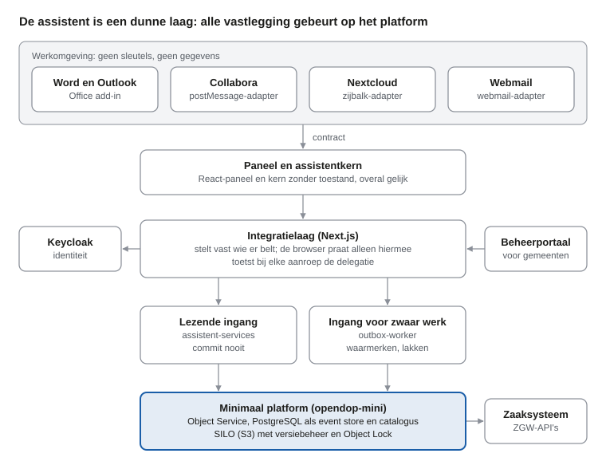

# Office Assistent — architectuur werkend prototype

*Bijgewerkt 20 november 2026 · Erik Hoekstra · Digitaal GemeenGoed*

> Dit bestand is de leidende versie van het architectuurdocument. Wijzigingen gaan via een commit of pull request in `oa-uitrol`, samen met de code waar ze over gaan.

## Doel en reikwijdte

Het prototype maakt de Office Assistent (MIRA) en de e-mailarchivering (ELSA) werkend, zodat het samenwerkingsverband Open WebConcept (OWC) ze kan doorontwikkelen. Het volgt de architectuur uit *XENA Deel II* en de demo's MIRA en ELSA, en bouwt alleen wat nodig is om die architectuur aantoonbaar te laten werken.

Binnen de reikwijdte:

- het assistentpaneel met de zes modules: metadateren, toegankelijkheid, persoonsgegevens en lakken, classificeren, waarmerken, workflow;
- adapters voor twee werkomgevingen, om het terugvalmechanisme vanaf het begin te tonen;
- de integratielaag met identiteit, twee ingangen en delegatietoets;
- een minimaal platform op PostgreSQL en SILO (S3);
- een beheerportaal voor gemeenten en hun IT-leveranciers;
- ELSA, hergebruikmakend van contract, kern en paneel.

Buiten de reikwijdte: de archiefwaardige opslag van XENA (later Nextcloud), de asynchrone keten met Debezium, Kafka en NiFi, en productierijpe beveiliging en beheer. Het prototype draait op testgegevens.

## Uitgangspunten

De assistent is een dunne laag op een platform: het werk en de vastlegging gebeuren op het platform, nooit in de werkomgeving. Daaruit volgen de regels die het prototype moet halen.

1. **Het object is de eenheid van waarheid.** Een stuk krijgt een identificatie in het platform, los van de plek waar het bestand staat. Het bestand draagt een afdruk; het platform is leidend.
2. **Geen eigen opslag voor de assistent.** Modules hebben geen eigen opslag en geen eigen logboek. Er ontstaat geen tweede archief naast platform en zaaksysteem.
3. **Elke vastlegging is een gebeurtenis.** Signaleren en beoordelen leggen niets vast; aanmaken, binden, versie vastleggen, lakken en waarmerken wel.
4. **De werkomgeving krijgt geen sleutels.** Wie er belt, stelt de integratielaag vast. De browser praat alleen met die laag.
5. **Twee ingangen.** Snelle, lezende vragen gaan langs de ene ingang en committen nooit; zwaar werk gaat langs de andere.
6. **Zichtbaar terugvallen.** Kan een werkomgeving iets niet, dan bereikt de assistent hetzelfde op een andere manier en zegt dat. Valt het platform weg, dan stopt zij met aanbieden wat zij niet kan waarmaken, zonder het werk te blokkeren.
7. **Het zaaksysteem blijft leidend voor zaken.** De definitieve representatie gaat via de ZGW-API's naar het zaaksysteem.
8. **MIRA en ELSA lopen synchroon.** Dezelfde functies, dezelfde presentatie; ELSA voegt alleen e-mailspecifieke regels toe.

## Bouwblokken

De medewerker werkt in zijn eigen werkomgeving; elke handeling loopt via adapter, kern en integratielaag naar het platform. Alleen het platform legt vast.

| Bouwblok | Verantwoordelijkheid | Wat het niet doet |
| --- | --- | --- |
| Adapter | Levert de inhoud, neemt haar terug en meldt de vermogens van de werkomgeving | Geen sleutels, geen gegevens, geen logica |
| Assistentkern | Kent het contract en de modules; toont bevindingen en stelt vragen in het paneel | Kent geen werkomgevingen; onthoudt niets tussen aanroepen |
| Integratielaag | Stelt vast wie er belt, toetst delegatie, kiest de ingang | Doet niets wat het platform niet kan |
| Platform | Objecten, versies, bindingen, gebeurtenissen, representaties | Vervangt het zaaksysteem niet |

**Vermogens en trappen.** Elke adapter levert drie basisvermogens: de inhoud opleveren, de inhoud vervangen en iets tonen. Optionele vermogens, zoals een deel van het document vervangen of melden wat in beeld is, maken een functie prettiger. Ontbreekt een vermogen, dan valt de functie zichtbaar terug, bijvoorbeeld door het document opnieuw te laden.

## Technologiekeuzes

Het prototype gebruikt één taal van paneel tot integratielaag: TypeScript, met React voor de interfaces. Doorslaggevend is dat een grote groep gebruikers nog op Microsoft werkt, en dat Office-invoegtoepassingen en de Next.js-integratielaag uit het integratiediagram React-georiënteerd zijn.

| Bouwblok | Keuze | Reden |
| --- | --- | --- |
| Contract | TypeScript-pakket met JSON Schema's | Gedeeld door adapters, kern en integratielaag; "voldoet aan het contract" wordt toetsbaar |
| Assistentkern | TypeScript, zonder framework | Gelijk in elke werkomgeving; zonder toestand tussen aanroepen |
| Paneel en beheerportaal | React met NL Design System-tokens en een theme per gemeente | Eén uiterlijk in elke host; geen tweede design system zoals Fluent UI |
| Inbedding | Office add-in, custom element, losse pagina | Eén paneel voor Office, Nextcloud en webmail |
| Integratielaag | Next.js (backend-for-frontend) | Sluit aan op het integratiediagram en op de React-stack |
| Identiteit | Keycloak (OIDC) | Al in gebruik of overwogen bij Haarlem; aansluiting op IRIS |
| Platform | PostgreSQL en SILO (S3) | Event store, catalogus en representaties; zie Minimaal platform |
| Assistent-services | Losse services achter de lezende ingang | Persoonsgegevens, toegankelijkheid, classificatievoorstel |

Alle code komt onder de EUPL 1.2, net als de bestaande demo's.

## Minimaal platform

PostgreSQL en SILO (S3) vormen een minimaal platform, niet de opslag van de assistent. Het is een kleine Object Service die later wordt vervangen door OpenDOP of de Nextcloud-stack, zonder dat paneel, kern of adapters iets merken.

Wat het platform levert:

- **Identiteit, metadata, relaties, versies, representaties en beleid**, de onderdelen van de synchrone kern uit het componentendiagram, in afgeslankte vorm.
- **PostgreSQL als event store en catalogus**: gebeurtenissen alleen toevoegen, leesmodellen erop, metadata als JSONB gevalideerd tegen een geversioneerd schema.
- **SILO voor representaties**, met versiebeheer en Object Lock vanaf het aanmaken van elke bucket. Object Lock kan achteraf niet meer worden aangezet.
- **Een outbox-tabel met een eenvoudige worker** voor zwaar werk zoals waarmerken en lakken, in plaats van Debezium en Kafka.

Wat het niet levert, en in de demo als *gesimuleerd* wordt gemarkeerd: afgedwongen bewaartermijnen, legal hold en bestuurde verwijdering (sleutelvernietiging kan sinds fase 1b wel, zie OA-ADR-008). Die horen bij de archiefwaardige laag, niet bij de assistent.

Multi-tenancy: één database met een `tenant_id` per gemeente en Row Level Security in PostgreSQL, en één S3-bucket per gemeente. De scheiding wordt zo in de database afgedwongen, niet alleen in de code.

## Beheerportaal en delegatiemodel

Het beheerportaal is een aparte React-applicatie voor gemeenten en hun IT-leveranciers. Het praat met hetzelfde platform via dezelfde integratielaag als het paneel, met eigen rollen en scopes.

| Onderdeel | Wat de beheerder doet |
| --- | --- |
| Metadatamodellen | Objecttypen, attributen en waardelijsten onderhouden, gemapt op MDTO en de selectielijst; elk model heeft versies en een vervaldatum |
| Regels | Regels op organisatieniveau voor MIRA en ELSA; team- en persoonlijke regels blijven in het paneel |
| Assistent-configuratie | Te detecteren persoonsgegevens, classificatieregels, waarmerkbevoegdheden, instellingen van het adresboek (GAB) |
| Rollen en delegatie | Rollen toekennen en delegaties aan leveranciers verlenen en intrekken |
| Audit | Elke beheerwijziging terugzien als gebeurtenis |

Voor metadatamodellen is hergebruik van de Objecttypen-API van Common Ground het onderzoeken waard: die beheert objecttypen als geversioneerde JSON Schema's.

**Delegatie.** De gemeente verleent en trekt zelf in, in het portaal. Een delegatie is een object in het platform met de gebeurtenissen *delegatie verleend* en *delegatie ingetrokken*. Keycloak levert alleen de identiteit van de leverancier; de integratielaag toetst bij elke aanroep of er een geldige delegatie is. Intrekken werkt daardoor direct, niet pas wanneer een token verloopt.

**Levenscyclus.** Ongeregelde groei van modellen en views is hetzelfde probleem als de netwerkschijven. Gebruiksstatistieken, vervaldata en een uitfaseerroute zitten daarom vanaf het begin in het portaal.

## Repositories

De repositories staan in de GitHub-organisatie [Digitaal-Gemeengoed](https://github.com/Digitaal-Gemeengoed), gescheiden naar bouwblok, zodat adapters en modules los van elkaar kunnen worden bijgedragen. Het platform staat bewust apart: het is niet van de assistent.

| Repository | Inhoud | Hangt af van |
| --- | --- | --- |
| `oa-contract` | Contract, vermogens, gebeurtenistypen, JSON Schema's | — |
| `oa-kern` | Assistentkern en de zes modules | oa-contract |
| `oa-paneel` | Paneel en venster Beoordelen in React, ook als custom element | oa-kern |
| `oa-adapters` | Adapters per werkomgeving, één monorepo | oa-contract |
| `oa-integratielaag` | Next.js-integratielaag, Keycloak, twee ingangen, delegatietoets | oa-contract |
| `oa-beheer` | Beheerportaal | oa-integratielaag |
| `opendop-mini` | Minimaal platform: Object Service, PostgreSQL, SILO (S3), outbox-worker | — |
| `oa-services` | Assistent-services achter de lezende ingang | oa-contract |
| `oa-wcag` | Toegankelijkheidscontrole van docx, xlsx en pptx, achter de assistent-services | — |
| `oa-uitrol` | Uitrol (Dockerfile, compose per VPS, scripts, Keycloak) en deze documentatie | alle bovenstaande |
| `elsa` | Aanvoer, IMAP-brug en e-mailregels | oa-contract, oa-kern, oa-paneel, opendop-mini |

De bestaande demo's (XENA, MIRA, ELSA) blijven als referentie onder EHa-1999 staan; de nieuwe repo's verwijzen ernaar in hun README.

`oa-uitrol` bevat de Dockerfile, de compose-bestanden per VPS, de Caddy-configuratie, de Keycloak-realm en het inlogthema. Zolang de pakketten `@digitaalgemeengoed/oa-*` niet in een registry staan, bouwt die alles uit de repositories naast elkaar.

## Uitrol over VPS'en

Vier VPS'en volstaan, verdeeld naar vertrouwensgrens: wat de browser bereikt, wat gegevens bewaart, wat rekent, en de werkomgeving zelf. Alleen VPS 1 is van buiten bereikbaar; de rest praat alleen met de integratielaag.

| VPS | Draait | Bereikbaar voor | Vanaf fase |
| --- | --- | --- | --- |
| 1 — toegang | Paneel en beheerportaal (statisch), integratielaag, reverse proxy met TLS | Browser en werkomgevingen | 1 |
| 2 — platform | `opendop-mini`, PostgreSQL, SILO (S3) met Object Lock, outbox-worker, optioneel OpenSearch | Alleen integratielaag | 1 |
| 3 — diensten | Assistent-services, Keycloak, optioneel OpenBao | Integratielaag; Keycloak ook voor de browser bij inloggen | 1 |
| 4 — werkomgeving | Nextcloud met Collabora, later de IMAP-brug van ELSA | Browser en mailclients | 2 |

Alles draait in containers met Docker Compose per VPS, zodat OWC de opzet één op één kan overnemen of later naar Kubernetes kan verplaatsen. Back-ups van PostgreSQL en SILO gaan naar een aparte bestemming buiten VPS 2.

## Inrichting per gemeente, beheer en huisstijl

Elke gemeente krijgt in beginsel een eigen inrichting; gemeenten die samenwerken, bijvoorbeeld in een gemeenschappelijke regeling (GR) voor IT-diensten, kunnen er één delen. Alle inrichtingen draaien dezelfde software, en de code blijft daarom multi-tenant (OA-ADR-009). Wat binnen een inrichting per gemeente gescheiden is:

| Onderdeel | Per gemeente gescheiden | Gedeeld binnen een inrichting |
| --- | --- | --- |
| Identiteit (Keycloak) | Attribuut `gemeente` per gebruiker, meegegeven bij het inloggen | Eén realm `gemeenten` en het Keycloak-beheer |
| Register (PostgreSQL) | `tenant_id` met Row Level Security; de gemeente wordt per transactie gezet | Eén database |
| Metadatamodel, classificatiemodel, delegaties | Per gemeente, met eigen versies | — |
| Opslag (SILO) | Eén bucket per gemeente | Eén installatie |
| Zoekindex (OpenSearch) | Eén index per gemeente; resultaten bevestigd in het register | Eén cluster |
| Sleutels (OpenBao) | Eén sleutel per object | Eén transit-engine |
| Paneel | Thema van de gemeente na het inloggen | Huisstijl van de inrichting vóór het inloggen |

**Beheer.** De inrichting is zo eenvoudig dat een gemeente zelf geen beheer hoeft te organiseren. Het beheer ligt naar verwachting bij een marktpartij, los van hosting en infrastructuur, die elk hun eigen heraanbestedingscyclus hebben (OA-ADR-010). Alles wat de beheerpartij doet, staat daarom in de repository `oa-uitrol`: installeren en bijwerken met één script per VPS, instellingen in `.env`, en geen kennis die alleen bij de hoster ligt. Al gerealiseerd: bijwerken zonder wachtwoord, en huisstijl en inlogthema die het bijwerkscript zelf ophaalt en instelt.

### Huisstijl en inlogscherm

Het inlogscherm van Keycloak (thema `oa`) en het paneel vóór het inloggen gebruiken de huisstijl van de inrichting (OA-ADR-011). De huisstijl is een design-tokens-pakket uit NL Design System; de Utrecht-componenten van paneel en inlogscherm lezen die tokens.

- **Kiezen:** `OA_HUISSTIJL` in `.env` op VPS 1 en VPS 3, een naam uit `huisstijl/catalogus.txt`. Zonder instelling: `voorbeeld`, het voorbeeldthema van NL Design System.
- **Catalogus:** per huisstijl een regel met de naam, de CSS-klasse waaronder de tokens staan, het npm-pakket, de versie en het CSS-bestand in het pakket. Nu: `voorbeeld` (`@nl-design-system-unstable/voorbeeld-design-tokens` 14.2.0) en `haarlem` (`@nl-design-system-unstable/haarlem-design-tokens` 1.0.0).
- **Een gemeente toevoegen:** de beheerpartij voegt één regel toe met het design-tokens-pakket van de gemeente. Heeft een gemeente nog geen pakket in NL Design System, dan blijft het voorbeeldthema; een eigen pakket maken is werk voor de gemeente of haar huisstijlbeheerder.
- **Ophalen:** `bijwerken.sh` haalt het pakket van npm, controleert de integriteit die npm opgeeft, en zet de CSS in `huisstijl/huisstijl.css`. Die staat niet in git: de huisstijl van een gemeente valt onder haar eigen licentie. Mislukt het ophalen of klopt het pakket niet, dan blijft de vorige huisstijl staan.
- **Gebruik:** Keycloak en de integratielaag krijgen de huisstijl aangekoppeld; Keycloak herstart als die verandert. Het paneel vraagt hem op bij de integratielaag (`/api/huisstijl`) en laadt de CSS erbij als die niet al in het paneel zit. Na het inloggen gaat het thema van de gemeente van de medewerker voor.
- **Lettertypen:** pakketten noemen soms een lettertype met een betaalde licentie (Haarlem: Sofia Pro). Dat wordt niet meegeleverd; het scherm valt terug op het lettertype dat het pakket als reserve noemt.

De volledige beschrijving staat in [huisstijl/README.md](../huisstijl/README.md); het inlogthema in [keycloak-thema/README.md](../keycloak-thema/README.md).

## ADR's

De eerste elf beslissingen, genummerd met het voorvoegsel OA om botsing met de ADR's van XENA en OpenDOP te voorkomen.

**OA-ADR-001 — React en TypeScript voor paneel, beheer en integratielaag.** *Context:* een grote groep gebruikers blijft op Microsoft werken; het integratiediagram noemt Next.js als API-laag. *Besluit:* React voor de interfaces, Next.js voor de integratielaag, een framework-loze kern. *Gevolg:* een native Nextcloud-app vraagt later een Vue-wrapper om dezelfde kern; die kosten zijn beperkt doordat de logica in de kern zit.

**OA-ADR-002 — Een minimaal platform, apart van de assistent.** *Context:* de assistent mag geen eigen opslag hebben; XENA-opslag komt later via Nextcloud. *Besluit:* `opendop-mini` op PostgreSQL en S3-opslag, in een eigen repository, achter het contract. *Gevolg:* vervangen door OpenDOP of de Nextcloud-stack raakt alleen de integratielaag.

**OA-ADR-003 — Outbox in plaats van Debezium en Kafka.** *Context:* het componentendiagram gebruikt CDC en Kafka voor asynchroon werk; voor een prototype is dat te zwaar. *Besluit:* een outbox-tabel in dezelfde transactie als de gebeurtenis, verwerkt door een worker. *Gevolg:* afwijking van Deel I, vergelijkbaar met ELSA zonder NiFi; het gebeurtenisformaat blijft gelijk, zodat de keten later kan worden ingeschoven.

**OA-ADR-004 — Delegatie door de gemeente, getoetst per aanroep.** *Context:* IT-leveranciers beheren namens gemeenten; de gemeente moet zelf verlenen en intrekken. *Besluit:* delegatie als object met gebeurtenissen, getoetst in de integratielaag; Keycloak alleen voor identiteit. *Gevolg:* intrekken werkt direct; delegaties zijn controleerbaar in de audit.

**OA-ADR-005 — Object Lock vanaf het begin.** *Context:* Object Lock kan in MinIO alleen bij het aanmaken van een bucket worden aangezet. *Besluit:* elke bucket met versiebeheer en Object Lock, ook al zijn de archieffuncties in het prototype gesimuleerd. *Gevolg:* geen migratie nodig wanneer bewaring echt wordt afgedwongen.

**OA-ADR-006 — SILO als S3-opslag.** *Context:* MinIO publiceert sinds oktober 2025 geen community-images meer en de community-repository is in april 2026 gearchiveerd. De opvolger AIStor is gesloten: de licentie verbiedt herdistributie en afgeleide werken, de gratis variant draait op één node en meer nodes vragen een betaald abonnement. *Besluit:* SILO, de open-source voortzetting van MinIO onder AGPLv3, vastgepind op een release en bijgewerkt na de release notes. *Gevolg:* OWC kan de opslag meeleveren en gemeenten kunnen haar zelf inzien; S3-API, `MINIO_*`-variabelen en schijfformaat blijven gelijk. Het risico is een jonge, kleine beheerder zonder SLA; dat blijft beheersbaar doordat het platform alleen de S3-API gebruikt, zodat AIStor Enterprise, Ceph of een opvolger kan worden ingezet. Terug naar MinIO-images is volgens SILO niet veilig. Object Lock, retention en legal hold zijn in de broncode nagegaan en worden op de eerste VPS getest.

**OA-ADR-007 — Zoeken met OpenSearch, bevestigd in het register.** *Context:* Woo-verzoeken en het terugvinden van stukken vragen zoeken op inhoud en metadata; OpenSearch hoort al bij de backbone van OpenDOP. *Besluit:* één index per gemeente, gevuld door de outbox-worker met de huidige stand van elk object; elk zoekresultaat wordt in het register bevestigd onder Row Level Security, de metadata komt uit het register en filters worden daar opnieuw toegepast. Optioneel, met een eigen compose-profiel. *Gevolg:* een fout of achterstand in de index kan nooit een stuk van een andere gemeente of een vernietigd stuk tonen. De index bevat wel leesbare tekst, ook van versleutelde stukken, en moet even goed beschermd worden als de opslag.

**OA-ADR-008 — Versleuteling per object met OpenBao.** *Context:* XENA en ELSA beloven dat een stuk onleesbaar gemaakt kan worden terwijl de opslag verwijderen weigert (Object Lock), en dat persoonlijke e-mail een eigen sleutel heeft. *Besluit:* elk object krijgt een eigen transit-sleutel in OpenBao; de inhoud wordt met AES-256-GCM versleuteld voordat zij de opslag in gaat, het platform bewaart alleen de verpakte datasleutel. Onleesbaar maken vernietigt die sleutel, alleen door de rol beheerder en met een reden die als gebeurtenis wordt vastgelegd. OpenBao draait op een andere VPS dan de gegevens. Waarmerksleutels horen hier niet: die staan in de HSM uit het VERA-ontwerp. *Gevolg:* vernietigen werkt ook voor back-ups van database en opslag, maar niet voor snapshots van OpenBao zelf; hun bewaartermijn moet begrensd zijn. OpenBao moet na een herstart worden ontzegeld, en sleutelbeheer achteraf uitzetten kan niet zonder verlies.

**OA-ADR-009 — Eén inrichting per gemeente of samenwerkingsverband, met multi-tenant code.** *Context:* gemeenten krijgen in beginsel een eigen inrichting; sommige delen er een, bijvoorbeeld in een GR voor IT-diensten. *Besluit:* elke inrichting draait dezelfde software, en de code blijft multi-tenant: register, metadatamodel, classificatiemodel, delegaties, opslag en zoekindex zijn per gemeente gescheiden; Keycloak geeft de gemeente mee als attribuut van de gebruiker. *Gevolg:* één gemeente is het geval met één tenant, en een GR werkt zonder aanpassing. Binnen een gedeelde inrichting delen de gemeenten wel het Keycloak-beheer, de transit-engine van OpenBao en de installaties van opslag en index; of dat volstaat, is een afweging per samenwerkingsverband (open punt).

**OA-ADR-010 — Beheer zonder eigen beheerorganisatie bij de gemeente, los van de hosting.** *Context:* de meeste gemeenten willen geen eigen beheer inrichten. Het beheer ligt naar verwachting bij een marktpartij, en hosting en infrastructuur worden apart aanbesteed, met een eigen heraanbestedingscyclus. *Besluit:* de inrichting is zo eenvoudig dat een gemeente zelf geen beheer hoeft te organiseren. Alles wat de beheerpartij doet, staat in `oa-uitrol` en in scripts; instellingen staan in `.env`; de inrichting vraagt van de hoster alleen VPS'en met Docker en een privaat netwerk. *Gevolg:* een wissel van hoster of beheerpartij vraagt geen kennisoverdracht buiten de repository. Nog te doen: één instellingenbestand per inrichting in plaats van één per VPS, en een geplande bijwerkronde die alleen getagde versies uitrolt.

**OA-ADR-011 — Huisstijl per inrichting uit NL Design System.** *Context:* het inlogscherm van Keycloak week af van de panelen. Vóór het inloggen weet Keycloak niet bij welke gemeente iemand hoort, en de huisstijl van een gemeente valt onder haar eigen licentie; die van Haarlem is alleen voor gebruik door de gemeente Haarlem. *Besluit:* een eigen inlogthema `oa` met de Utrecht-componenten van de panelen. De inrichting kiest haar huisstijl met `OA_HUISSTIJL` uit een catalogus van design-tokens-pakketten van NL Design System; de server haalt het pakket van npm met een controle van de integriteit; geen gemeentelijke huisstijl in git. Na het inloggen gebruikt het paneel het thema van de gemeente van de medewerker. *Gevolg:* een gemeente met een eigen inrichting heeft op inlogscherm en paneel haar eigen huisstijl; een gedeelde inrichting kiest het voorbeeldthema of de huisstijl van het samenwerkingsverband. Een gemeente zonder pakket in NL Design System valt terug op het voorbeeldthema, en lettertypen met een betaalde licentie worden niet meegeleverd.

## Fasering en open punten

Het prototype groeit in vier stappen, elk afzonderlijk te tonen.

1. **Skelet.** Contract, minimaal platform, integratielaag met Keycloak, en het paneel met metadateren en toegankelijkheid in één werkomgeving.
2. **Twee werkomgevingen.** Een tweede adapter met minder vermogens, zodat het terugvallen zichtbaar wordt; persoonsgegevens en lakken met het venster Beoordelen.
3. **Beheer en zwaar werk.** Beheerportaal met metadatamodellen en delegatie; classificeren, waarmerken en workflow via de outbox.
4. **ELSA.** E-mailaanvoer, IMAP-brug en e-mailregels op dezelfde kern en hetzelfde paneel.

Open punten:

- [ ] Welke werkomgeving komt eerst: Collabora (veel vermogens) of een Office add-in (meeste gebruikers)?
- [ ] Komt de Objecttypen-API in aanmerking voor de metadatamodellen, of bouwen we die in `opendop-mini`?
- [ ] Welke rollen en scopes krijgt een IT-leverancier minimaal in het beheerportaal?
- [ ] Waar landt waarmerken in het prototype: gesimuleerd, of een eerste koppeling met de VERA-architectuur?
- [ ] Welke gegevens gebruikt de demo-omgeving, en wie beheert de VPS'en namens OWC?
- [ ] S3-opslag: besloten in OA-ADR-006 (SILO). Nog te toetsen op de eerste VPS: Object Lock, retention en legal hold.
- [ ] De pakketten `@digitaalgemeengoed/oa-contract`, `oa-kern` en `oa-paneel` publiceren, zodat elke repository los bouwt. GitHub Packages vraagt daarvoor de scope van de organisatie (`@digitaal-gemeengoed`), dus de pakketnaam verandert dan mee.
- [ ] Scheiding binnen een gedeelde inrichting (GR): volstaan Row Level Security, een bucket en een index per gemeente, of zijn een realm, een transit-engine en opslag per gemeente nodig? Af te wegen met de CISO's van de deelnemende gemeenten (OA-ADR-009).
- [ ] Voor de beheerpartij: één instellingenbestand per inrichting en een geplande bijwerkronde op getagde versies (OA-ADR-010).
